# CognitiveOS Architecture

As of 2026-10-16. Exported from the [live doc](https://claude.ai/code/artifact/4b7a6c9b-6ef1-4f29-b68f-eeb09cecc5c7).

## Overview

CognitiveOS is a multi-repo agent platform. The part running on this Mac today is the adaptive-learning stack: a Frappe LMS that keeps the official record, one learning actor that diagnoses gaps and builds remediation, a control plane that authenticates and forwards every call, and a `/learn` page for learners.

A learner request runs: browser → workspace UI (`:3000`) → Kong (`:8000`) → Control API (`agentos`, `:8031`, `/api/v1/agentos/...`) → learning actor pod `cognitiveos-actor-tutor` (`:8051`, host `:8061`) → LMS REST API (`:8090`) and host Ollama (`:11434`). The control plane never runs actor cognition; it registers with zero scheduler capacity and answers `409 actor_not_running` when no runtime hosts the actor.

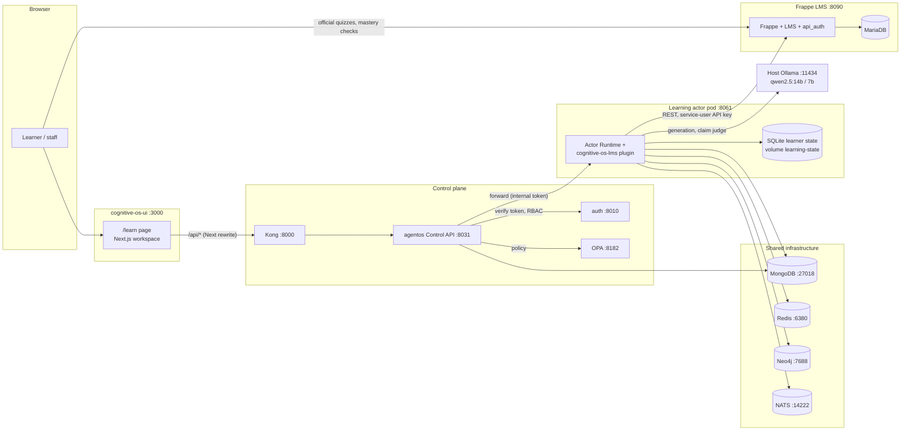

| Repo | Role | In the live learning stack |
| --- | --- | --- |
| `cognitive-os-core` | Kernel (observe, believe, plan, act), planner, governance, extension points | Yes, as a library |
| `cognitive-os-actor` | Actor Runtime and the shared base image | Yes, base of the actor image |
| `cognitive-os-domains` | Shared domain layer and domain registry | Yes, in the base image |
| `cognitive-os-control-plane` | Control API, scheduler, auth/RBAC, Kong, OPA, device registry | Yes |
| `cognitive-os-lms` | The learning actor plugin: mastery cycles, remediation, gates | Yes |
| `cognitive-os-learning` | Frappe LMS deployment: `api_auth` app, patches, `init.sh` | Yes |
| `cognitive-os-ui` | Frontends; `apps/workspace` holds `/learn` | Yes |
| `cognitive-os-scripts` | Stack and UI bring-up (`ui/ui.sh`, `stack.sh`) | Yes |
| `cognitive-os-commerce`, `-manufacturing`, `-media` | Other domain verticals, baked into the base image | No |
| `cognitive-os-robotics`, `-drone`, `-navigation` | Robot kinds (ROS, PX4, Nav2) | No |
| `cognitive-os-docs` | Papers, pitch, an older architecture PDF | No |

Everything below describes the working trees as of 2026-10-16.

## Control plane

The control plane (`cognitive-os-control-plane`, one `docker-compose.yml`) authenticates every call, checks a permission, and forwards learning calls to the actor's own runtime. It never hosts actor cognition.

| Service | Port (host) | Job |
| --- | --- | --- |
| Kong 3.6 | 8000, admin 8001 | Gateway; routes `/api/v1/agentos/*` to `agentos:8031` (long timeouts for model calls) |
| `agentos` | 8031 | Control API, scheduler, lifecycle, device registry, actor forwarding |
| `auth` | 8010 | Accounts, MFA (TOTP), roles and permissions, JWTs |
| OPA | 8182 | Policy decisions; production gates refuse to start without `OPA_URL` |
| MongoDB 7 | 27018 | `cognitive_platform`: actor state, audit records |
| Redis 7, Neo4j 5, NATS 2 | 6380, 7688, 14222 | Cache, belief graph, event bus for actors |

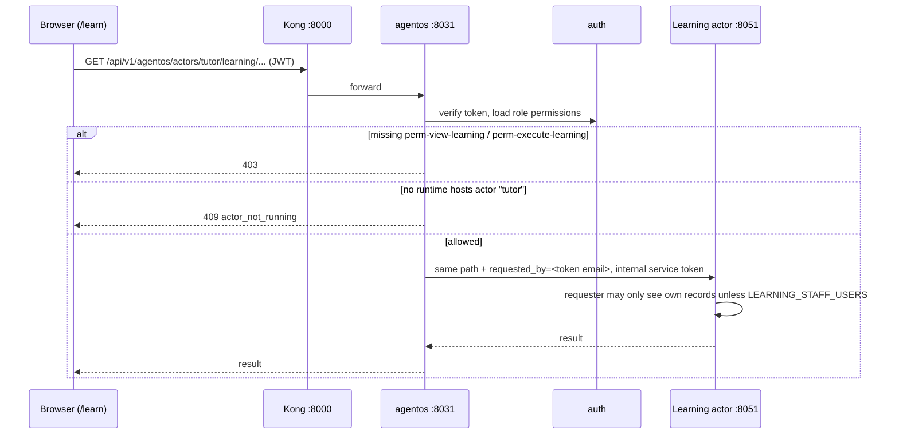

- **Forwarding:** `api/routes/learning_actor.py` proxies `/actors/{actor_id}/learning/...` via `api/actor_forwarding.py`. `requested_by` always comes from the verified token's email claim, never from the client; no email means `403` and nothing is forwarded.
- **Routing:** an actor is reachable only when its node id starts with `cognitiveos-actor-<actor_id>`; the control plane dials it at that hostname on the shared `cognitiveos` Docker network.
- **Governed writes:** AgentOS world ticks write through `run_governed_mutation` as `kernel:planetary-scheduler` (action `world.dynamics`), audited in `cognitive_platform.audit_records`.
- **Dev override:** plain `docker compose` also loads `docker-compose.override.yml`, which turns auth off. Recreate `agentos` only with `--project-directory <cp> -f docker-compose.yml`.

## LMS

The Frappe LMS is the system of record for courses, enrolments, lesson progress and graded quiz attempts; the actor reads it and writes only quiz assignments and the mastery-check quizzes it publishes. It is deployed from `cognitive-os-learning` (`docker-compose.yml`, `init.sh`, `local-deploy.sh` pins the Frappe and LMS commits).

| Container | Port (host) | Job |
| --- | --- | --- |
| `lms-frappe-1` | 8090 (web), 9090 (socket) | Frappe bench with the LMS and `api_auth` apps, site `lms.localhost` |
| `lms-mariadb-1` | internal 3306 | Frappe database |
| `lms-redis-1` | internal 6379 | Frappe cache and queue |

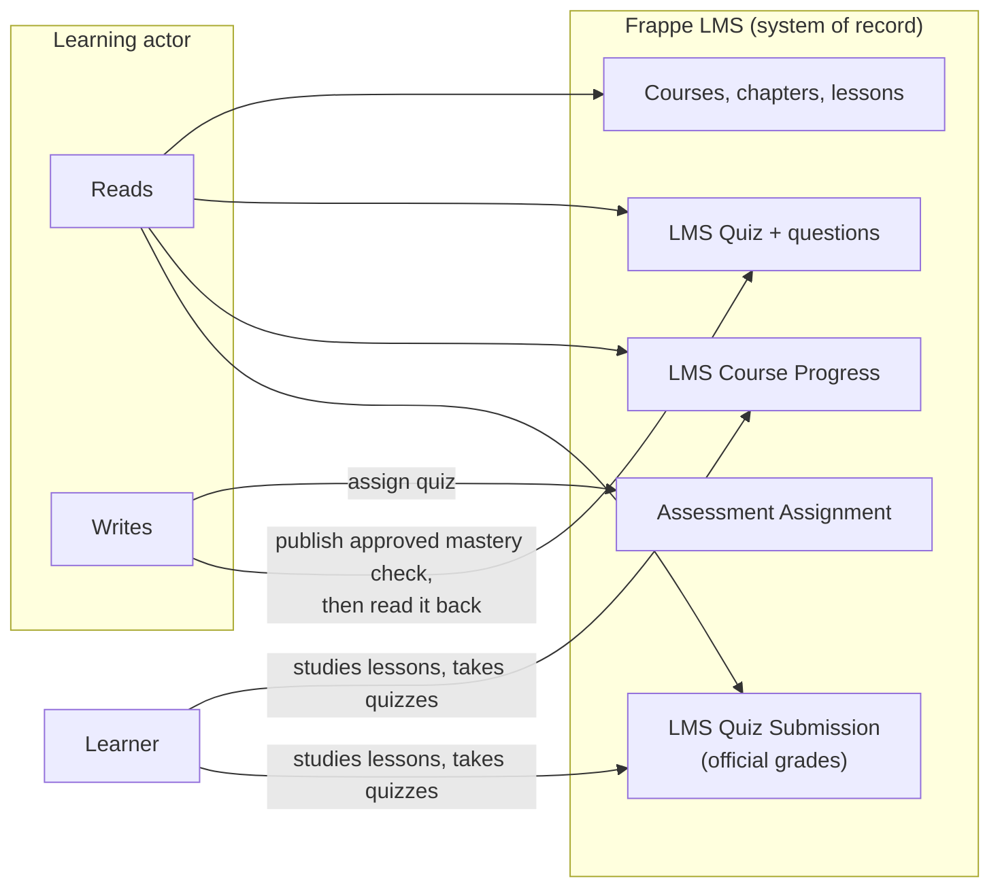

- **`api_auth` app:** adds the `/api/v1/...` REST layer the actor uses (`rest.py`, `assessments.py`, `quizzes.py`, `enrolments.py`, API keys, audit), beside Frappe's own `/api/resource/<Doctype>` document API.
- **Calls the actor makes:** `GET /api/v1/auth/me`, courses and enrolments, quiz assignments (`POST /api/v1/users/{learner}/quizzes` to assign), plus Frappe document reads of `Course Chapter`, `Course Lesson`, `LMS Quiz`, `LMS Course Progress` and `LMS Quiz Submission`.
- **Never written:** grades, submissions, lesson order, `current_lesson`, per-learner unlocks (the LMS doesn't support the last three).
- **Service user:** `learning-actor@example.com` with one API key; issuing a new key revokes the old one at once. Current key expires 2027-01-12.
- **Patches:** `api_auth/lms_patches/lesson-sidebar.patch` keeps the sidebar open on lesson pages for students; `calendar-page.patch`. Both are applied in the bench at `/home/frappe/frappe-bench/frappe-bench` and need `bench build --app lms`.
- **Courses in scope:** `python-101`, `python-lists`, `python-strings`, `python-loops` (`LEARNING_COURSES`). The newer three were built from specs by `~/.cognitive-os-live/courses/build_course.py`.
- **Learners:** they take official quizzes and published mastery checks in the LMS itself; module study and practice happen in `/learn`.

## Learning actor

The learning actor (`cognitive-os-lms`) is a plugin on the shared Actor Runtime. It runs one durable mastery cycle per (learner, course, required assessment) until the learner hits the target score (100% by default) on a valid check covering every required objective, or a limit hands the cycle to staff. Image `cognitiveos-learning-actor:local` is built on `cognitiveos-actor:local`.

### Mastery cycle

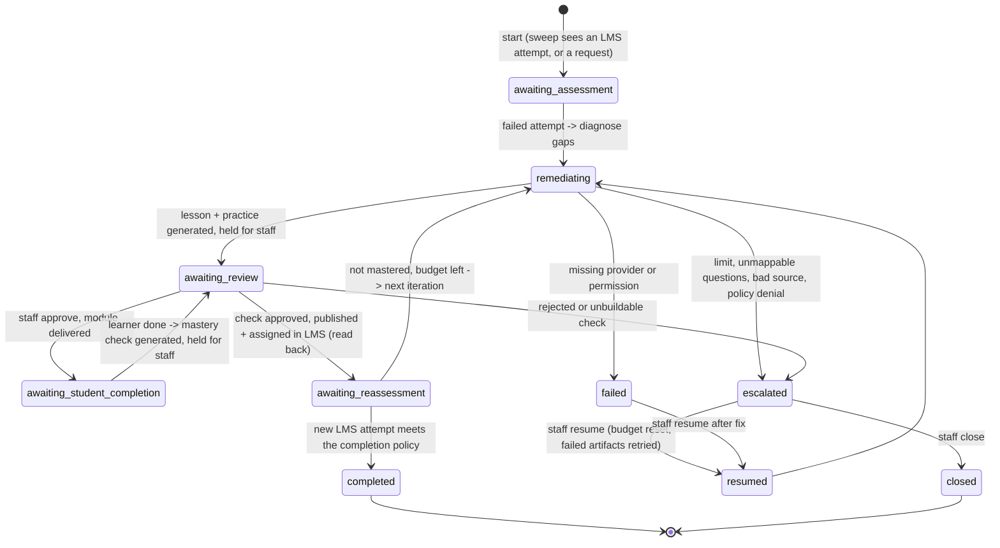

- **Diagnose:** each failed LMS question maps to an objective (lesson + concept), its source lesson and prerequisites; one gap per objective. Unmappable questions stay unresolved until staff map them.
- **Misconceptions** (`misconceptions.py`, version `misconceptions/2`): the wrong belief behind a wrong answer is derived by running 31 common-mistake code mutations. A record that fails its evidence check is `unreliable` and never given to a generator.
- **Evidence** comes only from LMS submissions (per-question correctness, never the learner's answers). Staff can mark a cycle's attempts as scripted test evidence; a completion then says `independent_learner_achievement: false`.
- **Chains:** after `completed` or `closed`, a new start opens cycle N+1 with `previous_cycle_id`.
- **Learner stage:** the cycle reports one of 14 learner-facing stages (`waiting_to_start` … `blocked`), computed from status, phase, job and pending review, for the UI.

### Content generation and gates

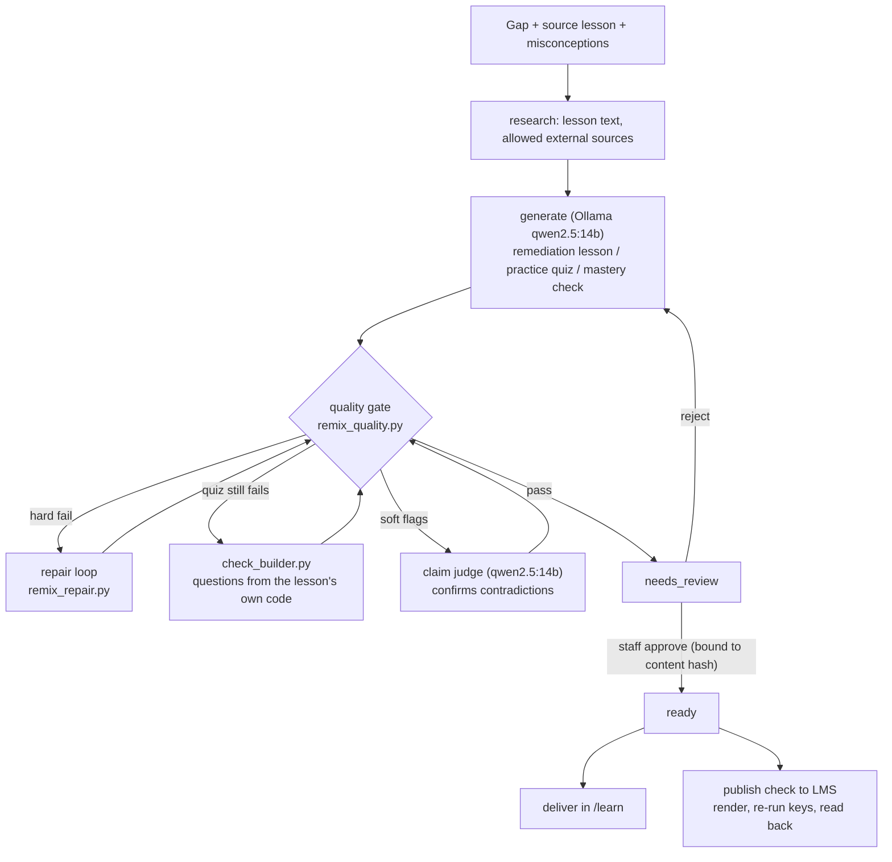

- **Formats:** `remediation_lesson`, `interactive_quiz` (practice and mastery checks); generation is content-addressed (`rmx-<hash>`), with claims that name the generating process so a dead process's claim is taken over at once.
- **Hard checks** include answer keys verified by running code in the sandbox (`sandbox.py`, no `type()` or dunders), `targets_misconceptions`, `misconceptions_are_mistakes`, `example_claims_hold`, `no_known_false_claims` (`false_claims.py`, each claim proven by a program), `question_self_contained`, `contradiction_confirmed`, answer-leak checks, and question diversity (reject at 0.8 similarity, review at 0.6).
- **Soft checks:** `no_negated_evidence` (candidates go to the claim judge) and `code_claims_reviewed` (staff-only list; the repair loop ignores it).
- **Policy** (`remix_policy.yaml`, live copy `live_v8.yaml`): external generation and research allowed, `allow_code_execution: true`, `require_review_for: [interactive_quiz, remediation_lesson]`.
- **Authored fallbacks:** staff can supply an authored lesson, practice or check (`.../authored-lesson`, `.../authored-check` routes) when generation can't pass the gate.

### Runtime

- **State:** cycles, artifacts and learner state live in SQLite (`learner_state.py`, core's `EdgeLocalStore`) on the `learning-state` Docker volume.
- **Sweep:** a background loop reads new LMS submissions per course since a stored watermark, starts or advances cycles, and resumes interrupted work (at most 3 recoveries in a row, then it escalates).
- **Jobs:** long work runs in the background (`wait=false`); the cycle stores a job record before any model call, so a restart can find and resume it.
- **Routes:** `routes.py` serves `/learning/learners/{learner}/courses/{course}/...` behind the internal service token: status, evaluations, recommendations, remix, mastery cycles, review queue, authored content.

## Learner UI

Learners use the `/learn` page in `cognitive-os-ui/apps/workspace` (Next.js, `:3000`) to see their courses, study generated material, answer practice questions and mark a module finished. Official quizzes and mastery checks open in the LMS.

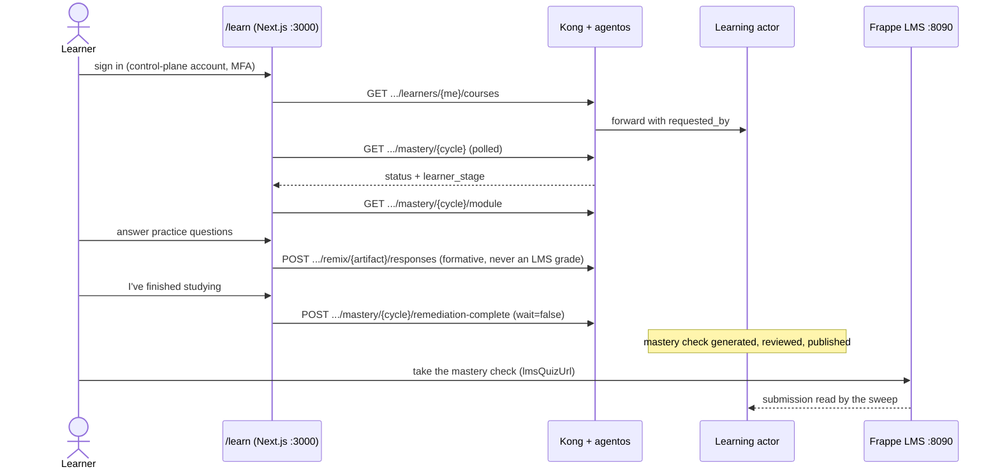

| File | Job |
| --- | --- |
| `app/learn/page.tsx` | The page: side menu (My courses, On this page, Open the LMS), course header, next step, stale-response guard |
| `components/learn/StudyMaterial.tsx` | Renders lessons and practice quizzes from a delivered module |
| `lib/learningClient.ts` | Typed calls to `/api/v1/agentos/actors/tutor/learning/...`: status, courses, mastery, module, remix, responses |
| `lib/learnerStage.ts` | Learner-facing wording for each `learner_stage`; neutral text when the actor sends none |
| `lib/apiClient.ts` | Base `/api/v1/agentos`; `next.config` rewrites `/api/*` to `NEXT_PUBLIC_API_TARGET` (Kong `:8000`) |

- **Run:** `NEXT_PUBLIC_POST_LOGIN_URL=/learn cognitive-os-scripts/ui/ui.sh up` (dev server, hot reload).
- **Accounts:** learners have both an LMS user and a control-plane user with role `learner` (ROLE-002); the email links the two.
- **Staff** work (review queue, approve, authored content, resume escalated cycles) has no UI yet: it goes through the API with `perm-view-actors` / `perm-execute-action`.

## Models

All model calls go to Ollama on the host (`http://host.docker.internal:11434`), running qwen2.5:14b for both generation and claim checking; no hosted model provider is configured.

| Use | Setting | Value |
| --- | --- | --- |
| Lesson, practice and check generation | `OLLAMA_MODEL`, `MODEL_BACKEND` | `qwen2.5:14b`, `ollama`, timeout 480 s |
| Claim judge (confirms soft contradictions) | `LEARNING_REMIX_CLAIM_JUDGE_MODEL`, `_PROVIDER` | `qwen2.5:14b`, `ollama` |
| Quality evaluator | `LEARNING_REMIX_EVALUATOR` | `none` (7b missed contradictions in offline tests) |
| Fallback model on disk | — | `qwen2.5:7b` (env backup `learning-actor.env.bak-20261015-14b` reverts to it) |

- **Cost on this Mac (16 GB):** about 10 minutes per lesson at ~9 tokens/s, with heavy swap; the stack is slow while it generates.
- **Quality:** 14b lessons often pass the gate; model-written quizzes often fail, so `check_builder.py` builds them from the lesson's code (marked `generation_model: verified-builder`, still reviewed).
- **Measured claim judge:** 8/8 recall and 7.5% false positives alone; combined with the rule check, 5/5 and 2 of 12 rule false positives.
- **Not automated:** Ollama is the Homebrew CLI with no service, so it must be started by hand after a reboot (`ollama serve`).
- **Open decision:** a hosted model would cut generation time and improve semantic checks; it needs an API key and is the user's call.

## Security and governance

Three layers stand between a caller and learner data: the control plane's token and permission check, the actor's own requester check, and the LMS's own permissions for the service user. Generated content reaches a learner only after a staff approval tied to its exact content.

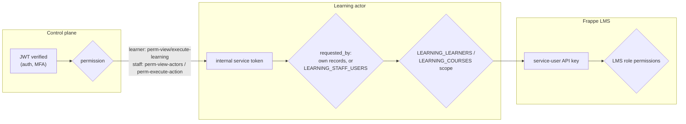

| Role | Permissions | Can do |
| --- | --- | --- |
| `learner` (ROLE-002) | `perm-view-learning`, `perm-execute-learning` | Own status, module, practice, own cycles (start, resume, mark complete) |
| Admin / staff | above + `perm-view-actors`, `perm-execute-action` | Review queue, approve or reject, authored content, question mapping, revise lesson, close, reopen, sweep, test-evidence mark |

- **Approvals bound to content:** an approval records the artifact's content hash (`content_hash.py`). Delivery and both LMS publish paths refuse an artifact whose content changed after approval.
- **Publish verification:** before writing a mastery check, each question is rendered as the learner will see it and its key re-checked by running the rendered code; after writing, the actor reads the quiz back and compares content and pass mark.
- **Data minimisation:** cycles keep a hashed learner reference and per-question correctness, never the learner's answers. Learners can delete their personal remix records (`DELETE .../remix`).
- **Audit:** actor events (`mastery_recovered`, `mastery_resumed`, `mastery_quiz_built`, …) go through `metrics.audit`; control-plane governed writes land in Mongo `cognitive_platform.audit_records`.
- **Key rotation:** launchd agent `com.cognitiveos.learning-actor-key-rotation` runs `actor/rotate_actor_key.sh --dev-site` daily at 03:30. It rotates within 14 days of expiry (2027-01-12, so first on 2026-12-30): issue and verify a key, recreate the actor at once, then check health and LMS auth. The log never holds secrets.
- **Known weakness:** in live tests the same staff account authored and approved content; there is no independent reviewer.

## Deployment and operations

Everything runs on one Mac under Docker Desktop, as three Compose projects on a shared `cognitiveos` network, plus the UI dev server and Ollama on the host. Recreating the actor goes through one script that refuses to run without a working LMS key.

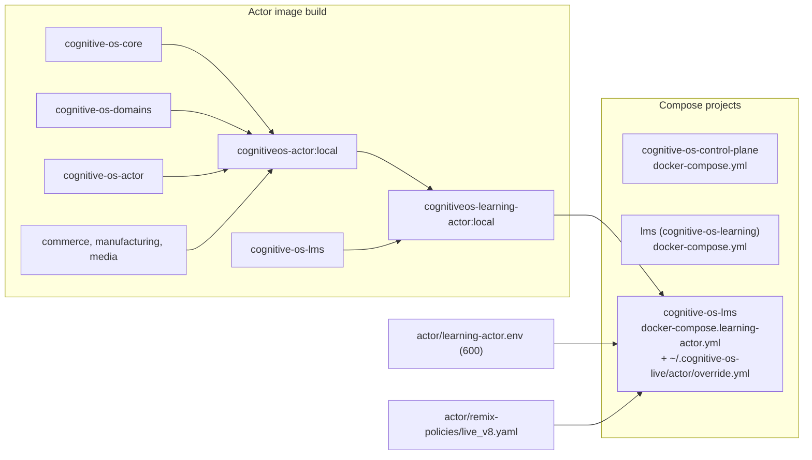

| What | How |
| --- | --- |
| Recreate the actor | `~/.cognitive-os-live/actor/recreate_actor.sh [--preflight]`; `ALLOW_CHANGE=KEY[,KEY]` for deliberate env changes |
| Issue an LMS key | `actor/provision_lms_key.py [--verify]` (one key per user: provision and recreate back to back) |
| Recreate `agentos` | `docker compose --project-directory <cp> -f docker-compose.yml up -d --no-deps agentos` (never plain `docker compose`) |
| Start the UI | `NEXT_PUBLIC_POST_LOGIN_URL=/learn cognitive-os-scripts/ui/ui.sh up` |
| Key rotation | launchd `com.cognitiveos.learning-actor-key-rotation`, daily 03:30 |
| Live-test helpers | `~/.cognitive-os-live/` (mode 700): `cycle.py`, `cycle_job.py`, `learner_cp.py`, Playwright scripts in `pw/` |

### After a reboot

Docker Desktop, the dependency containers and Ollama don't start themselves (seen 2026-10-16). In order:

1. `open -a Docker`. `agentos`, `auth`, `kong` and the learning actor restart on their own.
2. `docker start` the control plane's mongodb, nats, neo4j, opa and redis, then `lms-mariadb-1` and `lms-redis-1`, then `lms-frappe-1`.
3. `nohup ollama serve >> ~/.cognitive-os-live/logs/ollama.log 2>&1 &`.
4. Restart the UI dev server if it is needed.
5. Check for cycles left with `job: running` and resume them as staff until the sweep fix is deployed.

## Key flows

### From an LMS attempt to remediation

The sweep notices a new graded attempt and starts or resumes the learner's cycle in the background; everything up to staff review happens without a request.

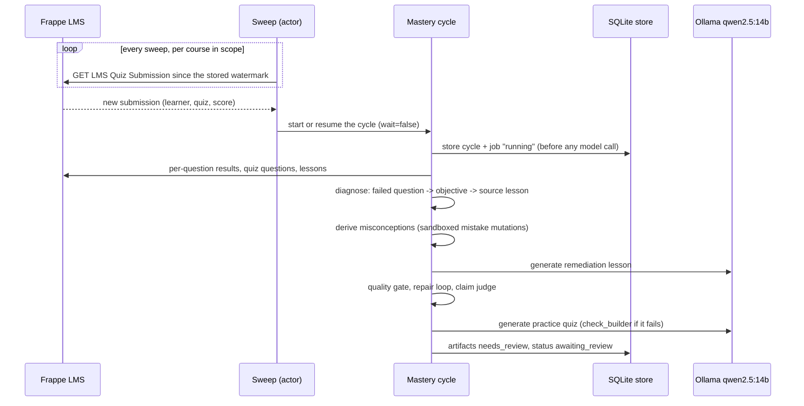

### Staff review and approval

An approval is bound to the exact content the reviewer saw; a later change voids it.

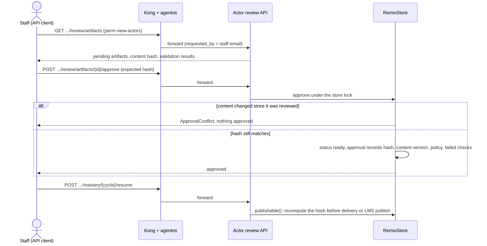

### Publishing a mastery check to the LMS

Nothing reaches the LMS until the rendered questions pass again, and the write is read back before the quiz is assigned.

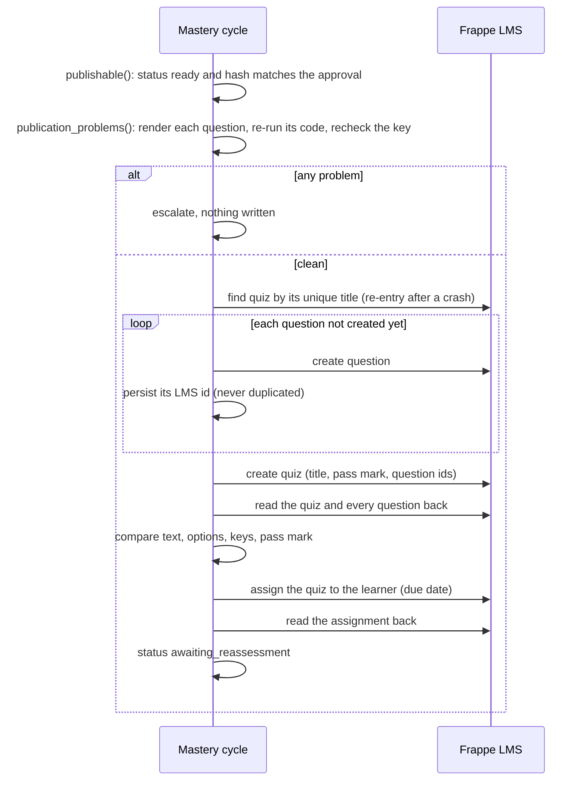

### Evaluating a mastery-check attempt

The decision rests on LMS evidence only: the score, which required objectives the questions covered, and the mastery evaluator.

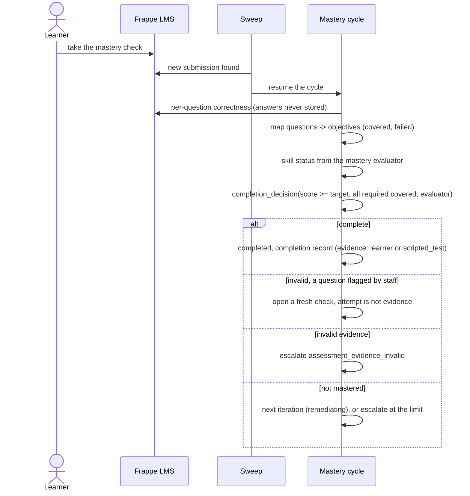

### Recovery after a restart

The sweep resumes work that a restart or crash left behind, and gives up to staff after 3 tries in a row. The waiting-cycle case is the fix that isn't deployed yet.

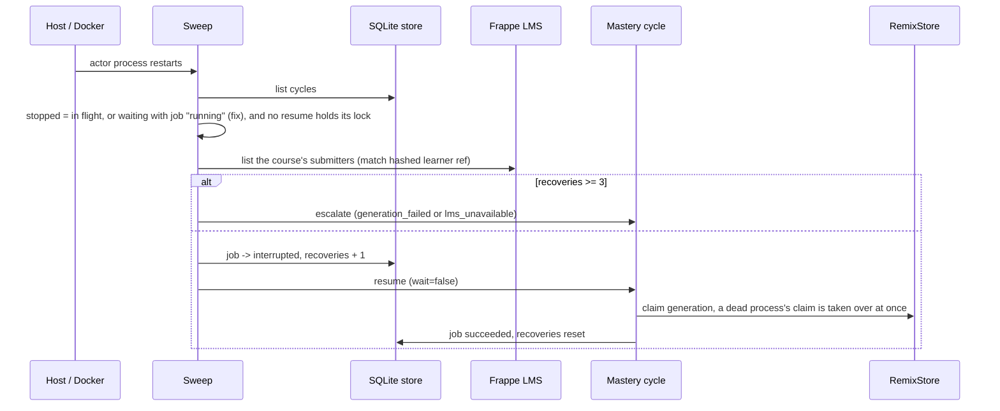

### LMS key rotation

A daily launchd job rotates the actor's LMS key shortly before it expires; because the LMS keeps one key per user, the actor is recreated right after the new key is issued.

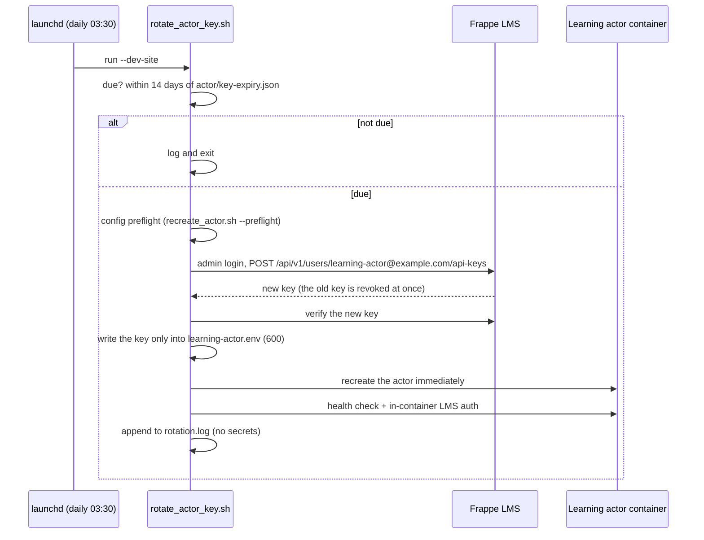

## Current state and known gaps

The live actor runs image `a0b94f39d74f` (built 2026-10-16 04:12 IST), which includes the self-contained-question gate, publish read-back, learner stages and test-evidence labelling. One fix is written and tested but not deployed: the sweep resume for waiting cycles with a stalled job.

| Item | State |
| --- | --- |
| Sweep recovers a stalled job on a waiting cycle (`mastery_cycle.py`, new regression test) | Tested (LMS suite 485 passed, 3 skipped), not deployed |
| carol, `python-loops`, cycle 2 `mc-61e507ab7406e41736ff` | `awaiting_review`: 2 mastery-check artifacts pending staff review |
| Commits | Learning-stack changes on `feat/learning-actor` branches with open PRs; `cognitive-os-lms` committed locally, no remote yet |
| Model benchmark (`tests/eval/model_benchmark.py`) | Never run; needs an explicit go-ahead |

- **Semantic accuracy:** the false-claims catalogue covers 17 claims; other wrong statements still need human review or a stronger model.
- **Model quizzes:** qwen2.5:14b mastery checks often fail validation; the builder or staff-authored checks fill in.
- **One cycle per quiz:** a closed cycle blocks a new one for that assessment until a chain start (`mastery_new_cycle_after`).
- **Lesson content:** "Variables" and "Defining Functions" in `python-101` are empty; "Control Flow" uses an unsupported `code` block. Left to an instructor.
- **No staff UI:** review and approval happen through the API.
- **Single machine:** no restart policy on the dependency containers; Ollama has no service.
